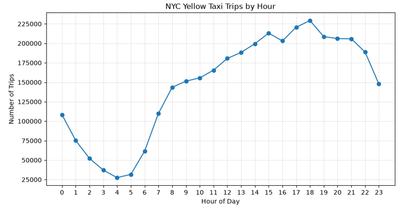
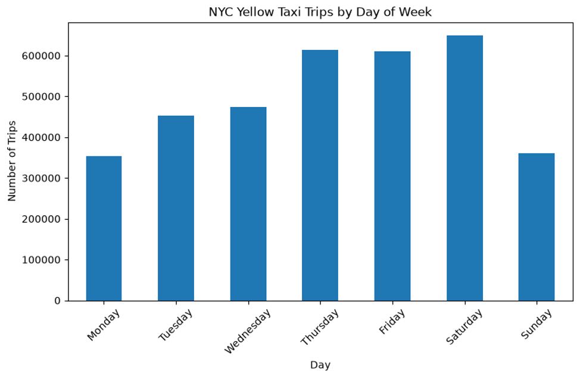
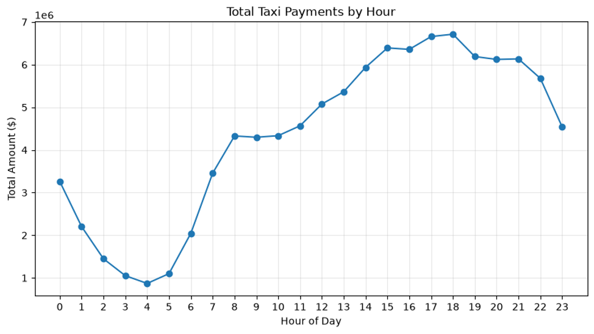
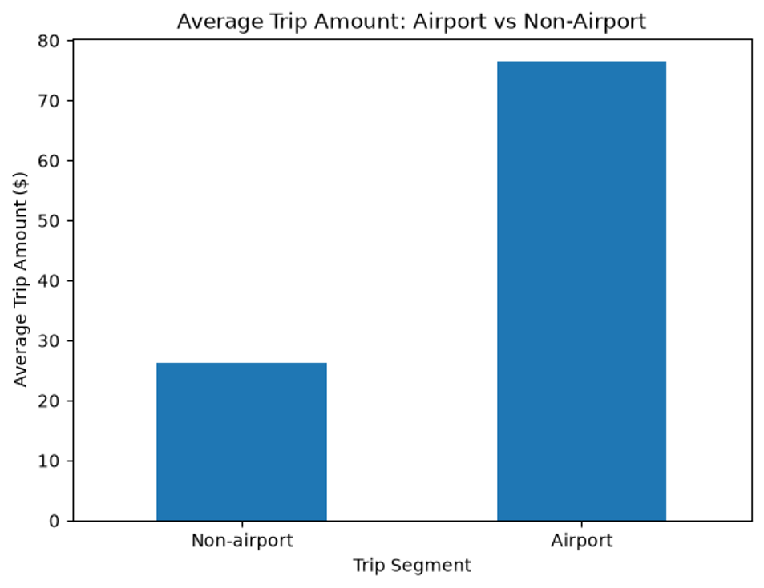
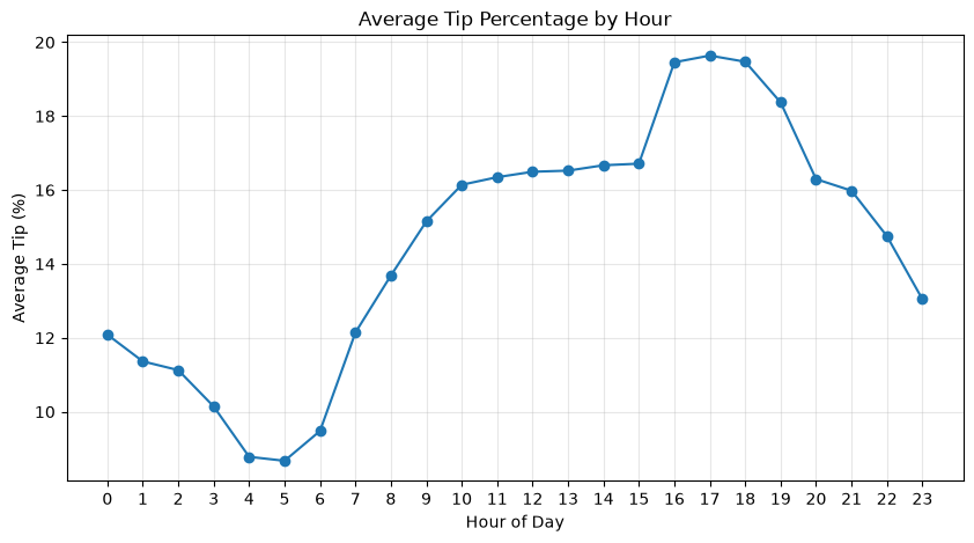
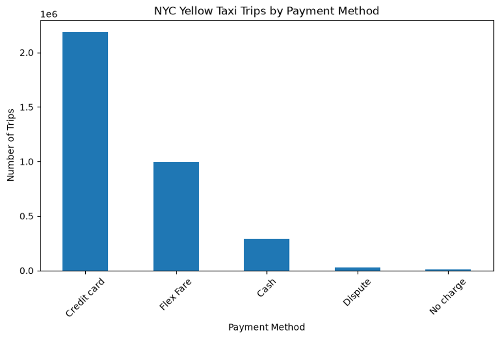

# NYC Yellow Taxi Revenue Analysis

## Project Overview

This project analyzes NYC Yellow Taxi trip data for **January 2026** to identify patterns in taxi demand, passenger payments, tipping behavior, airport trips, congestion-related charges, and pickup locations.

The project was developed as part of my Data Analytics portfolio and demonstrates practical skills in:

- Python

- Pandas

- NumPy

- Matplotlib

- SQL

- SQLite

- Jupyter Notebook

- GitHub

The analysis uses more than **3.5 million cleaned taxi trip records**.

---

## Business Questions

The project focuses on the following questions:

1. At what hours is taxi demand highest and lowest?

2. Which days of the week generate the most taxi trips?

3. How does the average trip amount change throughout the day?

4. How does tipping behavior vary by time of day?

5. How are taxi trips distributed across payment methods?

6. How do airport trips differ from non-airport trips?

7. Which NYC pickup zones generate the most trips and total passenger payments?

8. How do CBD congestion charges vary throughout the day?

---

## Dataset

The project uses the official **NYC Yellow Taxi Trip Record Data** published by the New York City Taxi & Limousine Commission.

Main sources:

- NYC Yellow Taxi Trip Records — January 2026

- NYC Taxi Zone Lookup Table

The trip dataset contains information such as:

- pickup and drop-off timestamps;

- pickup and drop-off location IDs;

- trip distance;

- passenger fare;

- tips;

- total passenger payment;

- payment type;

- airport fees;

- congestion-related charges.

The Taxi Zone Lookup Table was used to convert location IDs into actual borough and zone names.

---

## Tools and Technologies

### Python

Used for data loading, preparation, cleaning, feature engineering, analysis, and visualization.

Main libraries:

- `pandas`

- `numpy`

- `matplotlib`

### SQL

SQLite was used to perform relational analysis and demonstrate:

- `SELECT`

- `WHERE`

- `GROUP BY`

- `ORDER BY`

- `JOIN`

- `COUNT`

- `AVG`

- `SUM`

### Jupyter Notebook

Used to combine code, analysis, visualizations, and explanations in one reproducible workflow.

---

## Data Cleaning

Before analysis, the dataset was inspected for data quality issues.

The cleaning process included:

- checking missing values;

- checking duplicate rows;

- limiting records to January 2026;

- removing trips with non-positive distance;

- removing non-positive fare and total payment values;

- removing negative tips;

- calculating trip duration;

- identifying extreme values in distance, duration, fare, total amount, and tip percentage;

- applying conservative outlier thresholds.

The original dataset was preserved, while all cleaning operations were performed on copies of the data.

After cleaning and filtering, the main analytical dataset contained approximately **3.51 million trips**.

---

## Feature Engineering

Several new variables were created to support the analysis:

- `trip_duration_min` — trip duration in minutes;

- `pickup_hour` — hour when the trip started;

- `day_of_week` — weekday name;

- `is_weekend` — weekend indicator;

- `tip_percentage` — tip as a percentage of fare;

- `payment_method` — readable payment method category;

- `is_airport_trip` — airport-related trip indicator.

---

# Exploratory Data Analysis

## Taxi Demand by Hour

Taxi demand varies significantly throughout the day.

The lowest number of trips occurs during the early morning hours, especially around **4:00 AM**.

Demand starts increasing rapidly after approximately **6:00 AM** and remains high through the afternoon and evening.

The highest observed trip volume occurs around **6:00 PM**, with approximately **229,000 trips**.

This suggests a strong evening demand peak.

---

## Taxi Demand by Day of Week

Trip volume also differs substantially across the week.

The highest demand in the January 2026 dataset occurs on **Saturday**.

Thursday and Friday also show relatively high trip volumes, while Monday and Sunday have noticeably lower activity.

This suggests that taxi demand is influenced by both weekday travel and weekend activity.

---

## Total Payments by Hour

Total passenger payments follow a similar hourly pattern to trip volume.

Payments are lowest during the early morning hours and increase strongly throughout the day.

The highest total payment levels occur during the late afternoon and early evening.

The similarity between the trip-volume and payment curves suggests that overall payment activity is strongly influenced by the number of trips.

---

## Average Trip Amount by Hour

The average amount paid per trip does not follow exactly the same pattern as total trip volume.

The highest average trip amounts appear during the early morning period, especially around **5:00 AM**, when average trip values rise above $34.

During much of the daytime period, the average trip amount is closer to approximately $28–31.

This shows that periods with the highest trip volume are not necessarily the periods with the most expensive individual trips.

---

## Tipping Behavior

Average tip amounts vary considerably throughout the day.

Tips are lowest during the early morning hours and increase gradually during the daytime.

The highest average tip amount occurs around **4:00 PM**, reaching more than **$3 per trip**.

Average tip percentages show a similar pattern.

Tip percentages peak during approximately **4:00 PM–6:00 PM**, reaching roughly **19–20% of the fare**.

This suggests that passenger tipping behavior differs by time of day.

---

## CBD Congestion Fee

CBD congestion-related charges show a different hourly pattern from taxi demand and tipping behavior.

Average CBD congestion fees are relatively high during late-night hours, fall during the early morning period, and gradually increase again toward the evening.

This indicates that congestion-related charges are driven by different factors than passenger demand alone.

---

# Payment Method Analysis

Payment behavior is highly concentrated.

The cleaned dataset contains:

| Payment Method | Trips | Average Trip Amount | Total Payments |

|---|---:|---:|---:|

| Credit card | 2,188,327 | $29.44 | $64,426,517.22 |

| Flex Fare | 994,417 | $31.51 | $31,332,539.30 |

| Cash | 292,199 | $25.09 | $7,329,842.76 |

| Dispute | 27,612 | $29.68 | $819,648.14 |

| No charge | 9,066 | $25.18 | $228,277.81 |

Credit card payments represent approximately **62.3% of all analyzed trips**, making them the dominant payment method.

Flex Fare represents approximately **28.3%**, while cash accounts for approximately **8.3%**.

Credit card trips also generate the highest total passenger payment volume.


---

# Airport Trip Analysis

Airport-related trips were analyzed separately because they have very different characteristics from ordinary city trips.

| Segment | Trips | Avg. Distance | Avg. Duration | Avg. Trip Amount |

|---|---:|---:|---:|---:|

| Non-airport | 3,272,295 | 2.78 miles | 15.80 min | $26.23 |

| Airport | 239,326 | 13.21 miles | 35.19 min | $76.45 |

Airport trips represent approximately **6.8% of analyzed trips**.

However, their average trip amount is approximately **2.9 times higher** than non-airport trips.

Airport trips are also considerably longer in both distance and duration.

This makes airport transportation a financially important segment despite its relatively small share of total trip volume.

---

# SQL Analysis

SQLite was used to query the cleaned dataset and combine taxi trip records with the NYC Taxi Zone Lookup Table.

The analysis includes:

- high-value trip filtering with `WHERE`;

- payment method aggregation with `GROUP BY`;

- evening trip analysis;

- zone-level aggregation;

- relational `JOIN` between trip data and taxi zone data.

---

## High-Value Trips

SQL was used to identify the highest-value individual trips.

The largest observed trips in the filtered dataset had passenger payments above **$500**, with some fares approaching the upper filtering threshold.

These records demonstrate why outlier analysis and filtering were necessary before interpreting averages.

---

## Evening Trip Analysis

SQL analysis of the evening period shows:

| Pickup Hour | Trips | Avg. Trip Amount |

|---:|---:|---:|

| 16 | 203,130 | $31.30 |

| 17 | 220,754 | $30.17 |

| 18 | 229,311 | $29.28 |

| 19 | 208,675 | $29.67 |

| 20 | 206,126 | $29.71 |

Trip volume peaks at **6:00 PM**, while the average trip amount is actually higher at **4:00 PM**.

This reinforces the distinction between demand volume and average transaction value.

---

# Pickup Zone Analysis

A SQL `JOIN` was used to connect `PULocationID` with actual NYC taxi zones.

## Highest Trip Volume

The busiest pickup zone was:

**Upper East Side South, Manhattan — 152,325 trips**

Other high-volume areas included:

- Upper East Side North;

- JFK Airport;

- Midtown Center;

- Penn Station / Madison Square West;

- Lincoln Square East;

- Midtown East;

- Times Square / Theatre District;

- East Village;

- Upper West Side South.

Most of the highest-volume pickup zones are located in Manhattan.

---

## Highest Total Passenger Payments

The zone generating the highest total passenger payments was:

**JFK Airport — $11,185,937.25**

Its average trip amount was approximately **$79.18**.

LaGuardia Airport ranked second among zones by total payments:

**$5,634,582.71**, with an average trip amount of approximately **$69.32**.

By comparison, major Manhattan zones generate larger trip counts but substantially lower average trip amounts.

For example:

- Midtown Center: approximately **$26.68 per trip**

- Upper East Side South: approximately **$21.60 per trip**

- Times Square / Theatre District: approximately **$29.53 per trip**

This shows that the zones with the most trips are not necessarily the zones with the highest financial value per trip.

---

# Key Findings

1. **Taxi demand is strongly time-dependent.**  

   Activity is lowest during the early morning and reaches its highest level around 6:00 PM.

2. **Saturday is the busiest day of the week in the January 2026 dataset.**  

   Thursday and Friday also show high levels of taxi activity.

3. **High trip volume does not automatically mean high average trip value.**  

   Evening demand peaks around 6:00 PM, while some of the highest average trip amounts occur during lower-demand early morning hours.

4. **Airport trips form a small but high-value segment.**  

   They account for approximately 6.8% of analyzed trips, but their average trip amount is about 2.9 times higher than non-airport trips.

5. **Location strongly influences financial performance.**  

   Manhattan dominates trip volume, but JFK Airport generates the highest total payments among pickup zones.

---

# Business Implications

The analysis highlights several practical implications.

### Driver Supply

Driver availability could be aligned more closely with the strongest demand periods, especially during the late afternoon and early evening.

### Airport Segment

Airport trips deserve separate operational attention because they generate much higher average payments and require substantially longer travel times.

### Geographic Strategy

Trip volume and financial value should be evaluated separately.

High-volume Manhattan zones may be important for maximizing trip frequency, while airport zones may be more important for maximizing payment value per trip.

### Time-Based Analysis

Demand, average trip value, and tipping behavior follow different hourly patterns.

Operational decisions should therefore consider multiple metrics rather than relying only on total trip volume.

---

# Limitations

This project has several limitations:

- The analysis covers only **January 2026**, so conclusions should not automatically be generalized to other months or seasons.

- Only **NYC Yellow Taxi** trips are analyzed; other transportation services are not included.

- `tip_amount` does not fully represent cash tipping behavior, so tipping results should be interpreted carefully.

- Outlier filtering is based on conservative business rules and may exclude some valid extreme trips.

- `total_amount` represents the total amount charged to the passenger and includes fares, tips, taxes, surcharges, tolls, and other fees. It should therefore not be interpreted as pure company revenue.

- The project identifies descriptive relationships and patterns but does not establish causal relationships.

---

# Repository Structure

```text

nyc-taxi-revenue-analysis/

│

├── README.md

│

├── data/

│   ├── yellow_tripdata_2026-01.parquet

│   ├── taxi_zone_lookup.csv

│   └── nyc_taxi.db

│

├── notebooks/

│   └── 01_data_exploration.ipynb

│

├── sql/

│   └── analysis_queries.sql

│

└── images/

```

---

# Future Improvements

Possible extensions of the project include:

- analyzing several months of 2026 to identify seasonality;

- comparing weekday and weekend travel patterns;

- studying pickup-to-drop-off flows between taxi zones;

- building an interactive Power BI or Tableau dashboard;

- analyzing the relationship between trip distance, duration, and payment;

- comparing Yellow Taxi performance with other NYC transportation datasets.

---

## Data Source

New York City Taxi & Limousine Commission — NYC TLC Trip Record Data.

This project is intended for educational and portfolio purposes.